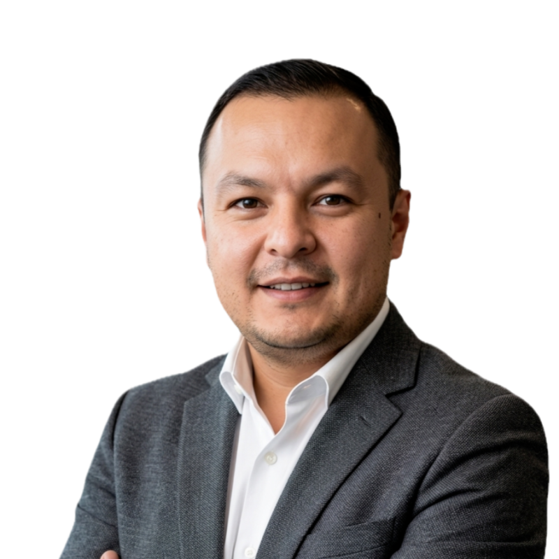

# ¡Hola! Soy Juan Sebastián Alvarado Ostos 👋

**Ingeniero Electrónico | Especialista en Automatización Industrial y Gestión de Mantenimiento (CGCM) | Maestrando en Ingeniería**

Ingeniero enfocado en confiabilidad de activos, automatización industrial, redes OT y sistemas de distribución eléctrica en entornos industriales y mineros. Actualmente lidero procesos de mantenimiento en planta de procesamiento de minerales, integrando analítica de datos, IoT y gestión estratégica de activos.

 

---

### 🔧 Áreas de Especialización y Stack Técnico

- **Automatización & Control:** PLC, HMI, SCADA, DCS, Redes Industriales OT, Instrumentación Industrial (ISA 5.1).
- **Gestión de Activos & Confiabilidad:** SAP PM, RCM (Mantenimiento Centrado en Confiabilidad), RCA (Análisis Causa Raíz), Planeación y Confiabilidad de Planta.
- **Potencia & Normativa:** Distribución eléctrica en media y baja tensión, subestaciones, RETIE, NTC 2050, NFPA 70E.
- **Energías Renovables & IoT:** Diseño y estructuración de proyectos solares fotovoltaicos (20 – 500 kWp), monitoreo industrial e Internet de las Cosas (IoT).
- **Datos & Desarrollo:** Python, análisis de datos aplicado a mantenimiento, gestión de información industrial.

---

### 💼 Trayectoria Destacada

- **Ingeniero de Mantenimiento de Planta (Planta CIP)** — *Aris Mining*
  - Gestión de confiabilidad, mantenimiento eléctrico y automatización en operaciones de extracción y procesamiento aurífero.
- **Ingeniero Residente Eléctrico** — *Consorcio OBSD*
  - Coordinación de ingeniería eléctrica, instrumentación y diseño de subestación de alta tensión para planta de oxígeno VPSA.
- **Ingeniero de Proyectos de Mantenimiento Eléctrico y Automatización** — *Acerías Paz del Río*
  - Más de 8 años liderando proyectos de modernización eléctrica y control industrial sin interrupción operativa (incluyendo experiencia como Coordinador de Mantenimiento Encargado).

---

### 🎓 Formación y Certificaciones

- **Maestría en Ingeniería** *(En curso)* — Universidad Santo Tomás (Enfoque en IoT, Gestión de la Información y estructuración de proyectos de energía solar fotovoltaica).
- **Gestor de Mantenimiento y Confiabilidad Certificado (CGCM)** — ACIEM.
- **Especialización en Gestión de Mantenimiento y Gestión de Activos.**
- **Especialización en Instrumentación Industrial.**
- **Ingeniero Electrónico.**

---

### 📫 Contacto

